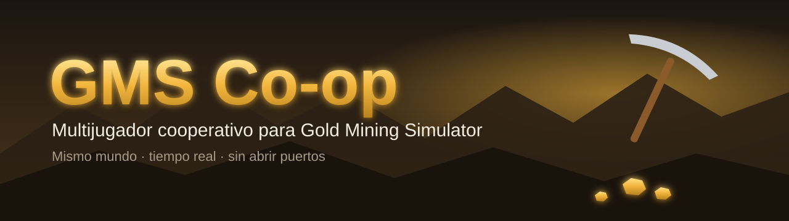
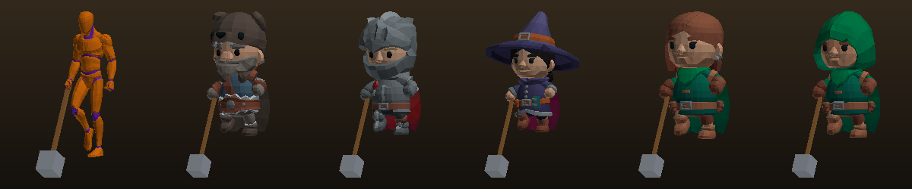

  

  
  
  
  

<h3 align="center">Juega <b>Gold Mining Simulator</b> con tus amigos en el mismo mundo, al mismo tiempo.</h3>

  

---

## ⛏️ ¿Qué es?

Un mod de **multijugador cooperativo** para Gold Mining Simulator, con un **launcher** que lo instala, lo actualiza y te conecta con tus amigos en un par de clics. Uno crea la partida, los demás entran a su mundo y todos excavan, manejan, compran y lavan oro juntos.

<table>
<tr>
<td width="50%">

### 🌍 Todo sincronizado
- Jugadores, camionetas, excavadoras y remolques
- Objetos, la carga en la caja, cuerdas y copiloto
- Terreno excavado y oro
- Dinero compartido, compras y terrenos
- Plantas de lavado, agua, combustible e interruptores
- Piezas y reparaciones: musgo, llantas, mangueras, trommel
- Tutorial y misiones

</td>
<td width="50%">

### 🚀 Conexión sin complicaciones
- **Conexión directa automática** entre PCs, **sin abrir puertos**
- **Cloudflare** de respaldo: funciona con cualquier internet
- **Steam**: invita a tus amigos o pásales un código
- **Red local**: la partida se encuentra sola
- Cambia de ruta **sin cortar la partida**
- Todo **cifrado** y firmado

</td>
</tr>
<tr>
<td>

### 🎮 Para jugar mejor
- 📍 **Marca un punto** con la rueda del mouse: "¡aquí hay oro!"
- 🏷️ Tu **nombre y color** sobre tu personaje
- 🧍 **Selector de personaje**, con la herramienta en la mano
- 🇲🇽 Juego **100 % en español**

</td>
<td>

### 💾 Tu avance, seguro
- El host **guarda solo** cada 5 minutos
- Cada amigo guarda un **respaldo** del mundo
- ¿Se cayó el host? **Sigue jugando solo** y retoma después
- Todos usan siempre **la versión más nueva** del mundo
- **Actualización automática** del launcher

</td>
</tr>
</table>

---

## 🕹️ Cómo jugar (3 pasos)

| | Host (crea la partida) | Amigos (se unen) |
|:-:|---|---|
| **1** | Abre `GMS Co-op.exe` | Abre `GMS Co-op.exe` |
| **2** | Elige tu partida y el modo (**Steam**, **Cloudflare** o **Red local**) | Pega el código que te pasaron (botón **Pegar**) |
| **3** | **Crear partida** → pasa el código a tus amigos | **Unirse** → recibes el mundo y entras |

> 💡 La primera vez el launcher te pregunta tu nombre y tu personaje. El mod se instala solo y **se actualiza solo** cuando sale una versión nueva.

### Modos de conexión

| Modo | Ideal para | Qué necesitas |
|---|---|---|
| ⚡ **Directo** (automático) | Siempre que los módems lo permitan | Nada: se activa solo |
| ☁️ **Cloudflare** | Cualquier internet, sin abrir puertos | Nada: el launcher hace todo |
| 🎮 **Steam** | Amigos con su propia cuenta | Steam abierto |
| 🏠 **Red local / VPN** | Misma casa o misma VPN | Estar en la misma red |

### ⌨️ Teclas en el juego

| Tecla | Acción |
|:-:|---|
| 🖱️ **Clic de la rueda** | Marcar un punto para todos |
| **F7** | Salir de la sesión co-op |
| **Ctrl + F6** | Host: sacar a un jugador |
| **F8 / F9 / F10** | Crear por Steam / crear por LAN / unirse por LAN (sin launcher) |

---

## 🧍 Personajes

  

Por defecto te ven como el **trabajador del propio juego**, con ropa de tu color. También puedes elegir el maniquí de Quaternius o los personajes de KayKit. Todos llevan **la herramienta que traes en la mano**.

---

## ❓ Preguntas frecuentes

<b>Windows dice "Windows protegió tu PC"</b>

El launcher no tiene firma digital (cuesta dinero). Pulsa **Más información → Ejecutar de todas formas**.

<b>¿Dónde se guarda el avance de mis amigos?</b>

En la partida del host. Además, cada amigo guarda un respaldo del mundo en su PC (`Coop_Respaldo_...`).

<b>Tenemos dos PCs con la misma cuenta de Steam</b>

Usen **Cloudflare** o **Red local**. Steam no conecta una cuenta consigo misma.

<b>Algo falló, ¿cómo lo reporto?</b>

En el launcher: **Ajustes → Enviar reporte**. Crea un `.zip` en tu Escritorio con todo lo necesario (si eres host, también los logs de tus amigos). Abre un <a href="https://github.com/RArtutos/gms-coop/issues">issue</a> y adjúntalo.

<b>¿Necesito comprar algo?</b>

Solo el juego, en Steam. El mod, el launcher y la conexión por Cloudflare son gratis.

---

## 🛠️ Para desarrolladores

| Carpeta | Contenido |
|---|---|
| [`GMSCoop/`](GMSCoop) | El mod (BepInEx 5 + HarmonyX, net472). Documentación: [README](GMSCoop/README.md) · [Arquitectura](GMSCoop/docs/ARCHITECTURE.md) |
| [`Installer/`](Installer) | El launcher (WPF, net48) |
| [`release/`](release) | `make_release.ps1` y `publish.ps1` ([notas](release/publish-notes.md)) |

## 🙏 Créditos

[BepInEx](https://github.com/BepInEx/BepInEx) · [HarmonyX](https://github.com/BepInEx/HarmonyX) · [cloudflared](https://github.com/cloudflare/cloudflared) · [Quaternius](https://quaternius.com) · [KayKit / Kay Lousberg](https://kaylousberg.com). Detalle de licencias en [`GMSCoop/avatars/LICENSES.md`](GMSCoop/avatars/LICENSES.md).

Gold Mining Simulator es marca de sus dueños. Este es un mod de fans, no oficial, y no contiene código ni recursos del juego.
